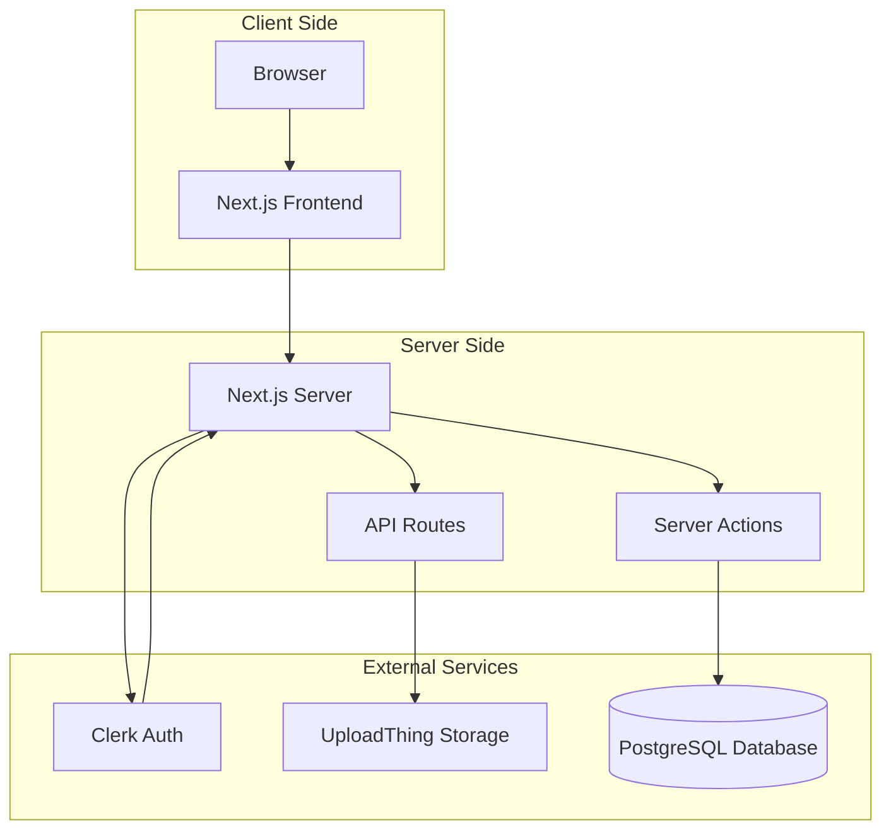

# Socially

A modern social media application built with Next.js 14, featuring user authentication, post creation with images, likes, comments, follows, and notifications.

> **Repository Status:** This project has been uploaded to GitHub but has not yet been run locally or tested. The application requires environment configuration and database setup before it can run.

**Note:** This application was originally developed as a tutorial project by Burak. Copyright © 2024 Burak. Licensed under MIT License.

## Application Preview

The following image is a static screenshot for visual reference. It is not a live demo, and application functionality has not necessarily been verified.


## Table of Contents

- [Features](#features)
- [Tech Stack](#tech-stack)
- [Project Status](#project-status)
- [Prerequisites](#prerequisites)
- [Quick Start](#quick-start)
- [Environment Variables](#environment-variables)
- [Documentation](#documentation)
- [Architecture](#architecture)
- [Known Issues](#known-issues)
- [License](#license)

## Features

### Implemented Features

- ✅ **User Authentication** - Sign up, login, logout via Clerk
- ✅ **User Profiles** - Customizable profiles with name, bio, location, website
- ✅ **Text Posts** - Create and share text-based posts
- ✅ **Image Posts** - Upload and share images via UploadThing
- ✅ **Feed** - Chronological feed of all posts
- ✅ **Likes** - Like and unlike posts with notifications
- ✅ **Comments** - Comment on posts with notifications
- ✅ **Follow System** - Follow and unfollow other users
- ✅ **Notifications** - Real-time notifications for likes, comments, and follows
- ✅ **Dark Mode** - Toggle between light and dark themes
- ✅ **Responsive Design** - Mobile-friendly interface
- ✅ **User Suggestions** - "Who to Follow" sidebar

### Not Implemented

The following features are commonly found in social media platforms but are **NOT** present in this application:

- ❌ Video uploads (only images supported)
- ❌ Search functionality
- ❌ Direct messages
- ❌ Stories
- ❌ Reposts/shares
- ❌ Content moderation tools
- ❌ Admin panel
- ❌ User blocking
- ❌ Subscriptions/payments

## Tech Stack

### Frontend
- **Framework:** Next.js 14.2.15 (App Router)
- **Language:** TypeScript 5
- **UI Library:** React 18
- **Styling:** Tailwind CSS 3.4.1
- **Components:** shadcn/ui (Radix UI primitives)
- **Icons:** Lucide React
- **Theming:** next-themes
- **Date Formatting:** date-fns
- **Notifications:** react-hot-toast

### Backend
- **Framework:** Next.js Server Actions and API Routes
- **Database ORM:** Prisma 6.1.0
- **Database:** PostgreSQL

### Third-Party Services
- **Authentication:** Clerk (@clerk/nextjs 6.9.6)
- **File Storage:** UploadThing (@uploadthing/react 7.1.4, uploadthing 7.4.2)

## Project Status

**Current Status:** Repository uploaded to GitHub, but application not yet tested locally

**Repository:** https://github.com/mrhasibuldev/x-media
**Application Name:** Socially
**Current Phase:** Repository presentation and documentation
**Next Phase:** Local development setup and testing

**IMPORTANT:**
- ❌ Database migrations have NOT been generated
- ❌ Application has NOT been tested with live services
- ❌ Environment variables are NOT configured
- ❌ Application build has NOT been verified
- ❌ Application has NOT been run locally

**Required Before Running:**
1. Configure environment variables (Clerk, PostgreSQL, UploadThing)
2. Run database migrations: `npx prisma migrate dev --name init`
3. Install dependencies: `npm install`
4. Test locally: `npm run dev`

**Note:** The screenshot above shows the application interface from the original tutorial. The application in this repository has not been run locally yet, so the current appearance may differ.

For detailed setup instructions, see [docs/LOCAL_DEVELOPMENT.md](docs/LOCAL_DEVELOPMENT.md).
For a comprehensive future development roadmap, see [docs/FUTURE_ROADMAP.md](docs/FUTURE_ROADMAP.md).

## Prerequisites

Before running this application, you need:

1. **Node.js** - Version 18 or higher
2. **PostgreSQL Database** - A running PostgreSQL instance (local or cloud)
3. **Clerk Account** - Free account at https://clerk.com
4. **UploadThing Account** - Free account at https://uploadthing.com

## Quick Start

### 1. Install Dependencies

```bash
npm install
```

### 2. Configure Environment Variables

Create a `.env` file in the project root:

```env
NEXT_PUBLIC_CLERK_PUBLISHABLE_KEY=your_clerk_publishable_key
CLERK_SECRET_KEY=your_clerk_secret_key
DATABASE_URL=your_database_url
UPLOADTHING_TOKEN=your_uploadthing_token
```

For detailed instructions on obtaining these values, see [docs/ENVIRONMENT_SETUP.md](docs/ENVIRONMENT_SETUP.md).

### 3. Run Database Migrations

**CRITICAL:** The database schema exists but migrations have not been generated.

```bash
npx prisma migrate dev --name init
```

This will create the necessary database tables.

### 4. Start Development Server

```bash
npm run dev
```

Open [http://localhost:3000](http://localhost:3000) in your browser.

## Environment Variables

The application requires the following environment variables:

| Variable | Purpose | Source |
|----------|---------|--------|
| `NEXT_PUBLIC_CLERK_PUBLISHABLE_KEY` | Clerk public key | Clerk Dashboard |
| `CLERK_SECRET_KEY` | Clerk secret key | Clerk Dashboard |
| `DATABASE_URL` | PostgreSQL connection string | Your PostgreSQL instance |
| `UPLOADTHING_TOKEN` | UploadThing API token | UploadThing Dashboard |

For detailed setup instructions, see [docs/ENVIRONMENT_SETUP.md](docs/ENVIRONMENT_SETUP.md).

## Documentation

Comprehensive documentation is available in the `docs/` directory:

### Getting Started
- [docs/PROJECT_OVERVIEW.md](docs/PROJECT_OVERVIEW.md) - Beginner-friendly project overview
- [docs/ENVIRONMENT_SETUP.md](docs/ENVIRONMENT_SETUP.md) - Environment variable configuration
- [docs/LOCAL_DEVELOPMENT.md](docs/LOCAL_DEVELOPMENT.md) - Local development setup

### Architecture
- [docs/ARCHITECTURE.md](docs/ARCHITECTURE.md) - Complete system architecture
- [docs/FRONTEND_GUIDE.md](docs/FRONTEND_GUIDE.md) - Frontend architecture and components
- [docs/BACKEND_GUIDE.md](docs/BACKEND_GUIDE.md) - Backend architecture and Server Actions
- [docs/DATABASE_GUIDE.md](docs/DATABASE_GUIDE.md) - Database structure and relationships

### Features
- [docs/AUTHENTICATION_GUIDE.md](docs/AUTHENTICATION_GUIDE.md) - Clerk authentication and authorization
- [docs/MEDIA_STORAGE_GUIDE.md](docs/MEDIA_STORAGE_GUIDE.md) - UploadThing file storage
- [docs/MEDIA_UPLOAD_CAPABILITIES_AND_ROADMAP.md](docs/MEDIA_UPLOAD_CAPABILITIES_AND_ROADMAP.md) - Image and video upload capabilities and future roadmap
- [docs/API_REFERENCE.md](docs/API_REFERENCE.md) - Server Actions and API endpoints

### Operations
- [docs/SECURITY.md](docs/SECURITY.md) - Security practices and known issues
- [docs/BACKUP_AND_RECOVERY.md](docs/BACKUP_AND_RECOVERY.md) - Backup and recovery procedures
- [docs/DEPLOYMENT_GUIDE.md](docs/DEPLOYMENT_GUIDE.md) - Deployment instructions
- [docs/GITHUB_WORKFLOW.md](docs/GITHUB_WORKFLOW.md) - Git and GitHub workflow
- [docs/TESTING_GUIDE.md](docs/TESTING_GUIDE.md) - Testing procedures
- [docs/KNOWN_ISSUES.md](docs/KNOWN_ISSUES.md) - Known issues and limitations

## Architecture

### System Overview



### Database Schema

The application uses PostgreSQL with the following tables:

- **User** - User accounts synced from Clerk
- **Post** - User posts with optional images
- **Comment** - Comments on posts
- **Like** - Likes on posts
- **Follows** - Follow relationships between users
- **Notification** - Notifications for likes, comments, and follows

For detailed schema information, see [docs/DATABASE_GUIDE.md](docs/DATABASE_GUIDE.md).

## Available Scripts

```bash
# Start development server
npm run dev

# Build for production
npm run build

# Start production server
npm start

# Run linter
npm run lint

# Generate Prisma Client (automatic postinstall)
npx prisma generate

# Create database migration
npx prisma migrate dev --name description

# Apply migrations in production
npx prisma migrate deploy

# Open Prisma Studio (database GUI)
npx prisma studio
```

## Known Issues

### Critical Issues

1. **Database Not Initialized** - Migrations have not been generated. Application cannot run without running `npx prisma migrate dev --name init`.

2. **Orphaned File Storage** - Deleting a post does not delete the associated file from UploadThing, potentially causing storage costs.

3. **No Rate Limiting** - No rate limiting on API endpoints or Server Actions, making the application vulnerable to abuse.

4. **Application Build Status** - Application has not been verified to build successfully.

For a complete list of known issues, see [docs/KNOWN_ISSUES.md](docs/KNOWN_ISSUES.md).

## Security Considerations

### Positive Security Findings

✅ No exposed secrets in source code
✅ Proper .gitignore excludes environment files
✅ Clerk handles authentication securely
✅ Prisma ORM prevents SQL injection
✅ Authorization checks in place for sensitive operations

### Security Gaps

⚠️ No rate limiting
⚠️ No input sanitization beyond ORM
⚠️ No content moderation tools
⚠️ No automated security scanning

For detailed security information, see [docs/SECURITY.md](docs/SECURITY.md).

## Future Roadmap

This repository represents the foundation for a social media application. The current implementation includes core social features (authentication, posts, likes, comments, follows, notifications) but has not yet been tested locally.

### Planned Development Phases

**Phase A (Current):** Repository presentation, documentation, and license clarification
- ✅ Comprehensive documentation created
- ✅ GitHub repository uploaded
- ✅ Readme improved
- 📝 Future roadmap defined

**Phase B:** Local development setup and dependency verification
- Install dependencies
- Verify build succeeds
- Run linting and type checking
- Resolve any build errors

**Phase C:** Database configuration and schema review
- Set up PostgreSQL database (local or cloud)
- Run database migrations
- Verify schema in Prisma Studio
- Test database connectivity

**Phase D:** Authentication and user profile verification
- Configure Clerk authentication
- Test sign up, sign in, sign out flows
- Verify user profile functionality
- Test profile editing

**Phase E:** Core social features verification
- Test post creation (text and images)
- Test likes and comments
- Test follow/unfollow
- Test notifications
- Verify feed functionality

**Phase F:** Media improvements
- Implement file deletion when posts are deleted
- Consider video upload support
- Optimize image handling

**Phase G:** Additional features (as approved)
- Search functionality
- Repost/share functionality
- Direct messages
- Stories
- Content moderation tools
- User blocking/muting

**Phase H:** Security, privacy, and testing
- Implement rate limiting
- Add input sanitization
- Set up automated testing
- Implement security scanning
- Add content moderation

**Phase I:** Deployment and maintenance
- Deploy to production (Vercel recommended)
- Set up monitoring
- Configure backups
- Establish maintenance procedures

### Missing Features

The following features are commonly found in social media platforms but are **NOT** currently implemented:

- ❌ Video uploads (only images supported)
- ❌ Search functionality
- ❌ Direct messages
- ❌ Stories
- ❌ Reposts/shares
- ❌ Content moderation tools
- ❌ Admin panel
- ❌ User blocking
- ❌ Subscriptions/payments
- ❌ Bookmarking

For a detailed roadmap with validation criteria and risks, see [docs/FUTURE_ROADMAP.md](docs/FUTURE_ROADMAP.md).

## License

MIT License

Copyright (c) 2024 Burak

Permission is hereby granted, free of charge, to any person obtaining a copy
of this software and associated documentation files (the "Software"), to deal
in the Software without restriction, including without limitation the rights
to use, copy, modify, merge, publish, distribute, sublicense, and/or sell
copies of the Software, and to permit persons to whom the Software is
furnished to do so, subject to the following conditions:

The above copyright notice and this permission notice shall be included in all
copies or the Software.

THE SOFTWARE IS PROVIDED "AS IS", WITHOUT WARRANTY OF ANY KIND, EXPRESS OR
IMPLIED, INCLUDING BUT NOT LIMITED TO THE WARRANTIES OF MERCHANTABILITY,
FITNESS FOR A PARTICULAR PURPOSE AND NONINFRINGEMENT. IN NO EVENT SHALL THE
AUTHORS OR COPYRIGHT HOLDERS BE LIABLE FOR ANY CLAIM, DAMAGES OR OTHER
LIABILITY, WHETHER IN AN ACTION OF CONTRACT, TORT OR OTHERWISE, ARISING FROM,
OUT OF OR IN CONNECTION WITH THE SOFTWARE OR THE USE OR OTHER DEALINGS IN THE
SOFTWARE.

## Acknowledgments

- Tutorial by [Burak](https://youtu.be/vUYopHWOURg)
- Built with [Next.js](https://nextjs.org/)
- Authentication by [Clerk](https://clerk.com/)
- Database by [Prisma](https://www.prisma.io/)
- File Storage by [UploadThing](https://uploadthing.com/)
- UI Components by [shadcn/ui](https://ui.shadcn.com/)

