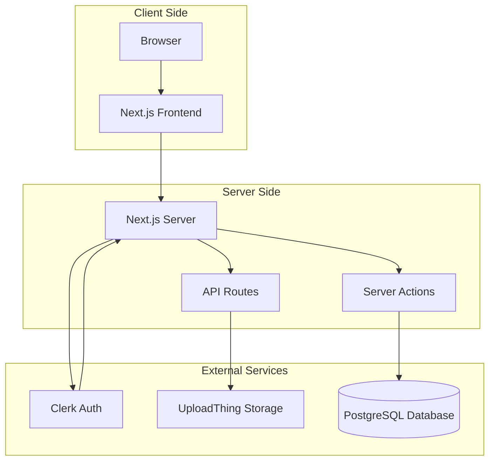
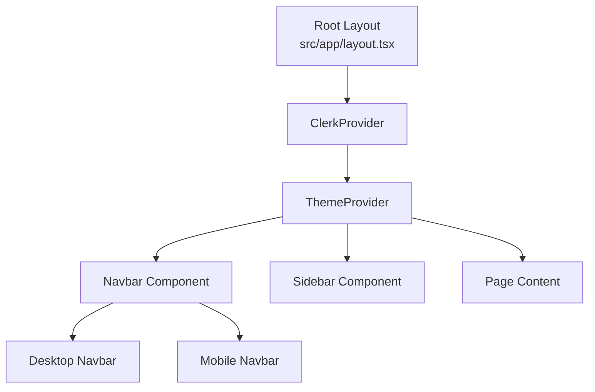
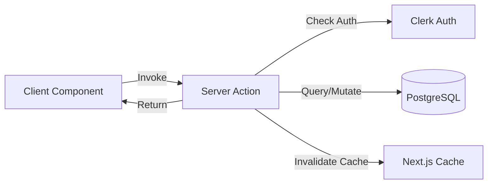
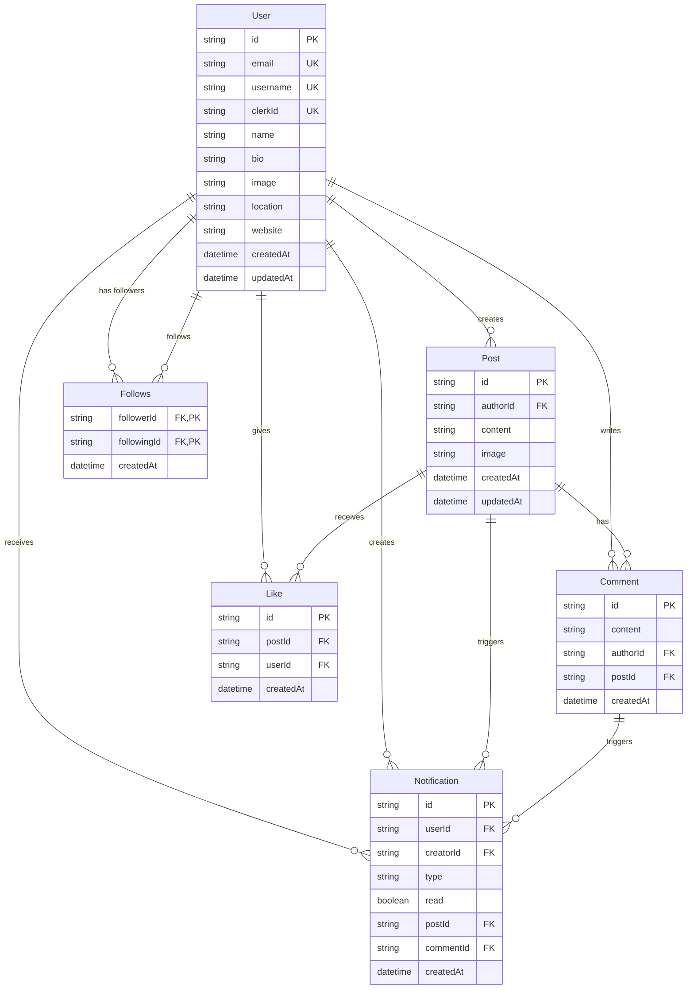
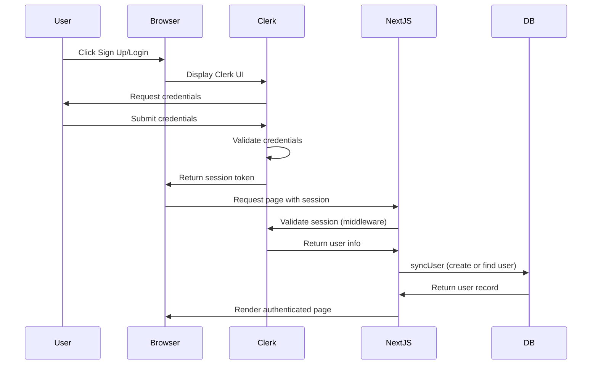
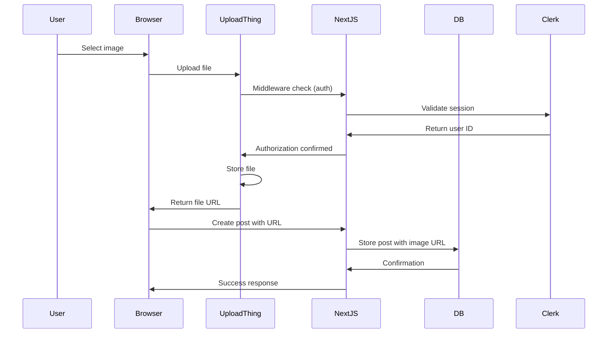
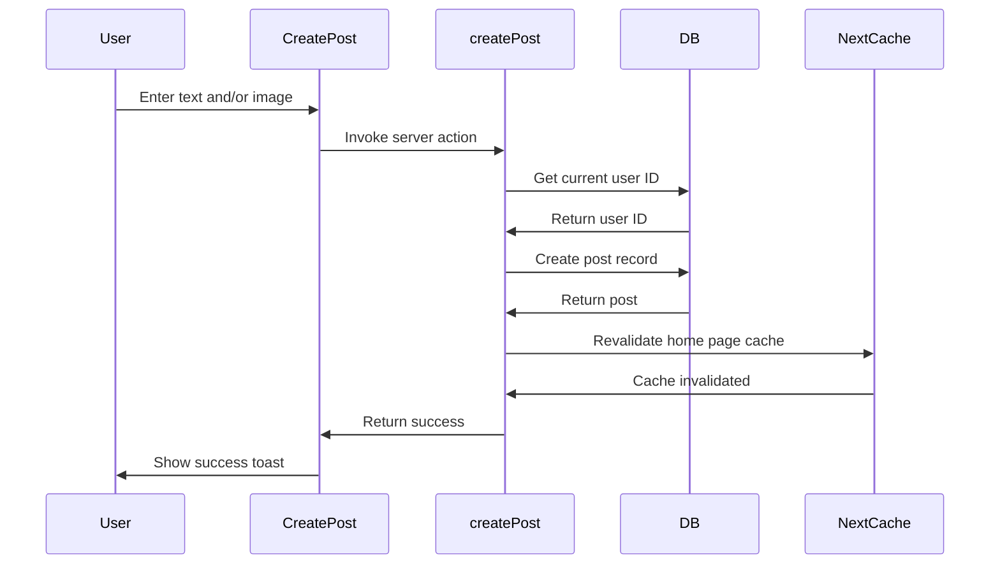
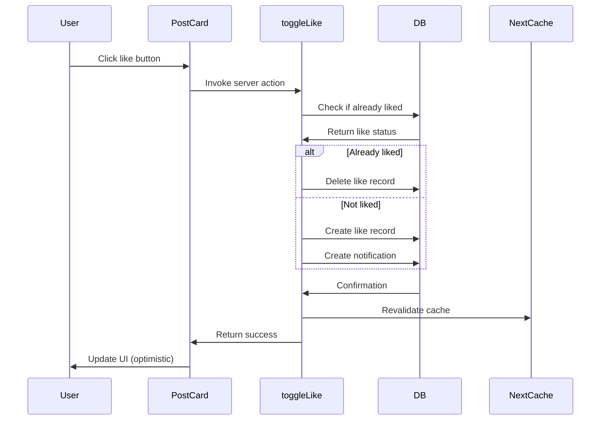

# Architecture Documentation

## System Architecture Overview

Socially is a full-stack Next.js application with the following architecture:



## Frontend Architecture

### Technology Stack

- **Framework:** Next.js 14.2.15 with App Router
- **Rendering:** Hybrid (Server Components by default, Client Components where needed)
- **Language:** TypeScript 5
- **Styling:** Tailwind CSS 3.4.1
- **UI Components:** shadcn/ui (Radix UI primitives)
- **State Management:** React hooks + Next.js Server Actions
- **Theme:** next-themes for dark mode support

### Application Structure



### Component Hierarchy

```
RootLayout (src/app/layout.tsx)
├── ClerkProvider (Authentication wrapper)
├── ThemeProvider (Dark mode wrapper)
├── Navbar
│   ├── DesktopNavbar
│   └── MobileNavbar
├── Sidebar (Desktop only)
└── Page Content (Dynamic)
    ├── Home Page (src/app/page.tsx)
    │   ├── CreatePost
    │   ├── PostCard (repeated)
    │   └── WhoToFollow
    ├── Notifications Page (src/app/notifications/page.tsx)
    │   └── NotificationSkeleton (loading state)
    └── Profile Page (src/app/profile/[username]/page.tsx)
        ├── ProfilePageClient
        ├── PostCard (repeated)
        └── FollowButton
```

### Page Routes

| Route | File | Type | Purpose |
|-------|------|------|---------|
| `/` | `src/app/page.tsx` | Server Component | Home feed with all posts |
| `/notifications` | `src/app/notifications/page.tsx` | Client Component | User notifications |
| `/profile/[username]` | `src/app/profile/[username]/page.tsx` | Server Component | User profile page |
| `/tasks` | `src/app/tasks/page.tsx` | Server Component | Demo tasks page (not part of core features) |

### Key Components

#### Server Components (Render on Server)
- `src/app/layout.tsx` - Root layout
- `src/app/page.tsx` - Home page
- `src/app/profile/[username]/page.tsx` - Profile page server component
- `src/components/Sidebar.tsx` - User sidebar
- `src/components/Navbar.tsx` - Navigation bar
- `src/components/WhoToFollow.tsx` - User suggestions

#### Client Components (Render in Browser)
- `src/app/notifications/page.tsx` - Notifications page
- `src/app/profile/[username]/ProfilePageClient.tsx` - Profile page client logic
- `src/components/CreatePost.tsx` - Post creation form
- `src/components/PostCard.tsx` - Post display with interactions
- `src/components/FollowButton.tsx` - Follow/unfollow button
- `src/components/ImageUpload.tsx` - Image upload component
- `src/components/MobileNavbar.tsx` - Mobile navigation
- `src/components/ModeToggle.tsx` - Theme toggle
- `src/components/ThemeProvider.tsx` - Theme provider wrapper

## Backend Architecture

### Server Actions vs API Routes

The application uses two backend patterns:

1. **Server Actions** (`src/actions/`): Primary business logic for mutations
2. **API Routes** (`src/app/api/`): External integrations and demo endpoints

### Server Actions

Server Actions are the primary backend logic for the application. They run on the server and can be called directly from client components.



#### Server Action Files

| File | Functions | Purpose |
|------|-----------|---------|
| `src/actions/post.action.ts` | createPost, getPosts, toggleLike, createComment, deletePost | Post-related operations |
| `src/actions/user.action.ts` | syncUser, getUserByClerkId, getDbUserId, getRandomUsers, toggleFollow | User-related operations |
| `src/actions/profile.action.ts` | getProfileByUsername, getUserPosts, getUserLikedPosts, updateProfile, isFollowing | Profile-related operations |
| `src/actions/notification.action.ts` | getNotifications, markNotificationsAsRead | Notification operations |

### API Routes

API Routes handle external service integrations and demo endpoints.

| Route | File | Purpose |
|-------|------|---------|
| `/api/uploadthing` | `src/app/api/uploadthing/route.ts` | UploadThing file upload handler |
| `/api/tasks` | `src/app/api/tasks/route.ts` | Demo tasks API (in-memory storage) |

## Database Architecture

### Database Technology

- **Database:** PostgreSQL
- **ORM:** Prisma 6.1.0
- **Schema Location:** `prisma/schema.prisma`
- **Migration Status:** **NOT INITIALIZED** - No migrations folder exists

### Database Schema



### Table Descriptions

#### User Table
Stores user account information synced from Clerk.

**Fields:**
- `id` (string, primary key) - Unique user ID
- `email` (string, unique) - User email address
- `username` (string, unique) - Username for profile URLs
- `clerkId` (string, unique) - Clerk user ID for authentication mapping
- `name` (string, optional) - Display name
- `bio` (string, optional) - User biography
- `image` (string, optional) - Profile image URL
- `location` (string, optional) - User location
- `website` (string, optional) - Personal website URL
- `createdAt` (datetime) - Account creation timestamp
- `updatedAt` (datetime) - Last update timestamp

**Relationships:**
- One-to-many to Post (as author)
- One-to-many to Comment (as author)
- One-to-many to Like
- Self-referencing many-to-many via Follows (followers and following)
- One-to-many to Notification (as recipient and creator)

#### Post Table
Stores user posts with optional images.

**Fields:**
- `id` (string, primary key) - Unique post ID
- `authorId` (string, foreign key) - User who created the post
- `content` (string, optional) - Post text content
- `image` (string, optional) - UploadThing image URL
- `createdAt` (datetime) - Post creation timestamp
- `updatedAt` (datetime) - Last update timestamp

**Relationships:**
- Many-to-one to User (author)
- One-to-many to Comment
- One-to-many to Like
- One-to-many to Notification

**Cascade Delete:** Deleting a user deletes all their posts.

#### Comment Table
Stores comments on posts.

**Fields:**
- `id` (string, primary key) - Unique comment ID
- `content` (string) - Comment text
- `authorId` (string, foreign key) - User who wrote the comment
- `postId` (string, foreign key) - Post being commented on
- `createdAt` (datetime) - Comment creation timestamp

**Indexes:**
- Composite index on (authorId, postId) for performance

**Relationships:**
- Many-to-one to User (author)
- Many-to-one to Post
- One-to-many to Notification

**Cascade Delete:** Deleting post or user deletes comments.

#### Like Table
Tracks which users liked which posts.

**Fields:**
- `id` (string, primary key) - Unique like ID
- `postId` (string, foreign key) - Post being liked
- `userId` (string, foreign key) - User who liked
- `createdAt` (datetime) - Like timestamp

**Indexes:**
- Composite index on (userId, postId)
- Unique constraint on (userId, postId) - prevents duplicate likes

**Relationships:**
- Many-to-one to User
- Many-to-one to Post

**Cascade Delete:** Deleting post or user removes likes.

#### Follows Table
Tracks follow relationships between users.

**Fields:**
- `followerId` (string, foreign key, primary key) - User who follows
- `followingId` (string, foreign key, primary key) - User being followed
- `createdAt` (datetime) - Follow timestamp

**Primary Key:** Composite on (followerId, followingId) - prevents duplicate follows

**Indexes:**
- Composite index on (followerId, followingId)

**Relationships:**
- Self-referencing: Both fields reference User table

**Cascade Delete:** Deleting a user removes their follow relationships.

#### Notification Table
Stores notifications for likes, comments, and follows.

**Fields:**
- `id` (string, primary key) - Unique notification ID
- `userId` (string, foreign key) - Notification recipient
- `creatorId` (string, foreign key) - User who triggered notification
- `type` (enum) - Notification type: LIKE, COMMENT, or FOLLOW
- `read` (boolean) - Whether notification has been read
- `postId` (string, foreign key, optional) - Related post
- `commentId` (string, foreign key, optional) - Related comment
- `createdAt` (datetime) - Notification creation timestamp

**Indexes:**
- Composite index on (userId, createdAt) for efficient fetching

**Relationships:**
- Many-to-one to User (recipient - "userNotifications")
- Many-to-one to User (creator - "notificationCreator")
- Many-to-one to Post (optional)
- Many-to-one to Comment (optional)

**Cascade Delete:** Deleting related entities removes notifications.

## Authentication Flow



### Clerk Integration

- **Middleware:** `src/middleware.ts` - Clerk middleware validates session on all routes
- **Provider:** `src/app/layout.tsx` - ClerkProvider wraps entire application
- **Server Actions:** `src/actions/user.action.ts` - syncUser function creates local user record
- **Components:** Clerk UI components (SignInButton, SignUpButton, UserButton, SignOutButton)

### User Sync Process

When a user logs in for the first time:

1. Clerk authenticates the user
2. `syncUser` server action is called from Navbar
3. Function checks if user exists in database by `clerkId`
4. If not found, creates new User record with Clerk data
5. User's Clerk ID is stored in `clerkId` field for future lookups

## File Upload Flow



### UploadThing Configuration

- **Route:** `/api/uploadthing`
- **Endpoint:** `postImage`
- **Max File Size:** 4MB
- **Max File Count:** 1 per post
- **File Types:** Images only
- **Authentication:** Clerk middleware required

**Configuration File:** `src/app/api/uploadthing/core.ts`

## Request Flow Examples

### Creating a Post



### Liking a Post



## Data Fetching Patterns

### Server-Side Data Fetching

Most data fetching happens in Server Components using Server Actions:

```typescript
// Example from src/app/page.tsx
const posts = await getPosts(); // Server Action
const dbUserId = await getDbUserId(); // Server Action
```

### Client-Side Data Fetching

The notifications page uses `useEffect` for client-side fetching:

```typescript
// Example from src/app/notifications/page.tsx
useEffect(() => {
  const fetchNotifications = async () => {
    const data = await getNotifications();
    setNotifications(data);
  };
  fetchNotifications();
}, []);
```

### Cache Invalidation

Server Actions use `revalidatePath` to invalidate Next.js cache:

```typescript
revalidatePath("/"); // Invalidate home page cache
```

## Error Handling

### Server Actions

All Server Actions use try-catch blocks:

```typescript
try {
  // Database operation
  return { success: true, data };
} catch (error) {
  console.error("Error message", error);
  return { success: false, error: "Error message" };
}
```

### Client Components

Client components use toast notifications for user feedback:

```typescript
const result = await createPost(content, imageUrl);
if (result?.success) {
  toast.success("Post created successfully");
} else {
  toast.error("Failed to create post");
}
```

## Security Considerations

### Authentication

- All routes protected by Clerk middleware
- Server Actions check for authenticated user
- Authorization checks (e.g., only post author can delete)

### Authorization

- Post deletion requires authorship check
- Profile editing requires ownership check
- File uploads require authenticated user

### Data Validation

- Prisma ORM prevents SQL injection
- Clerk handles password security
- UploadThing enforces file size and type limits

### Known Security Gaps

- No rate limiting on API endpoints
- No input sanitization beyond database ORM
- No content moderation tools
- No automated security scanning

See [SECURITY.md](./SECURITY.md) for detailed security information.

## Performance Considerations

### Database Indexes

The following indexes are defined for performance:

- Comment: Composite index on (authorId, postId)
- Like: Composite index on (userId, postId)
- Follows: Composite index on (followerId, followingId)
- Notification: Composite index on (userId, createdAt)

### Cascade Deletes

Cascade deletes are used to maintain data integrity:

- Deleting a user deletes their posts, comments, likes, and follow relationships
- Deleting a post deletes its comments, likes, and notifications

### Optimistic UI Updates

The like feature uses optimistic updates for better UX:

```typescript
// Update UI immediately
setHasLiked((prev) => !prev);
setOptmisticLikes((prev) => prev + (hasLiked ? -1 : 1));

// Then call server action
await toggleLike(post.id);
```

## Deployment Architecture

### Recommended Deployment

- **Platform:** Vercel (recommended for Next.js)
- **Database:** Managed PostgreSQL (Supabase, Neon, or Railway)
- **Authentication:** Clerk (managed service)
- **File Storage:** UploadThing (managed service)

### Environment Requirements

- Node.js 18+
- PostgreSQL database
- Clerk application
- UploadThing application

See [DEPLOYMENT_GUIDE.md](./DEPLOYMENT_GUIDE.md) for detailed deployment instructions.
