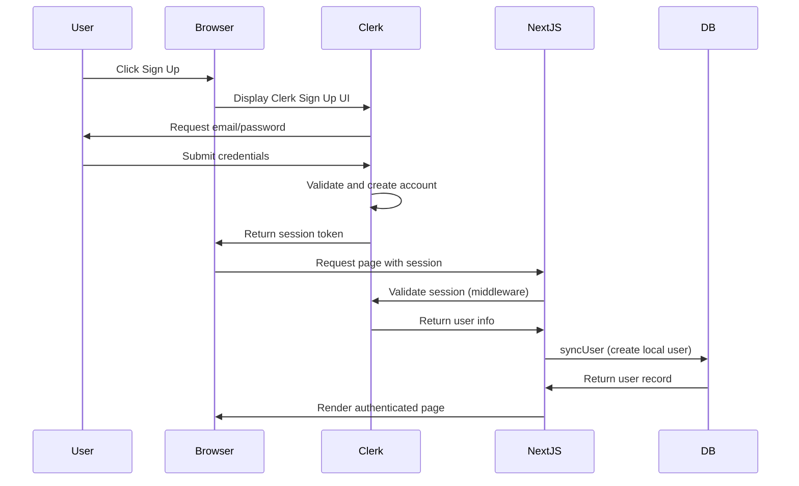
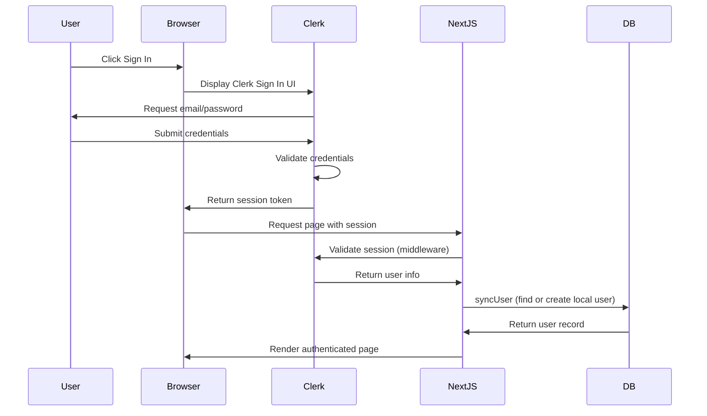
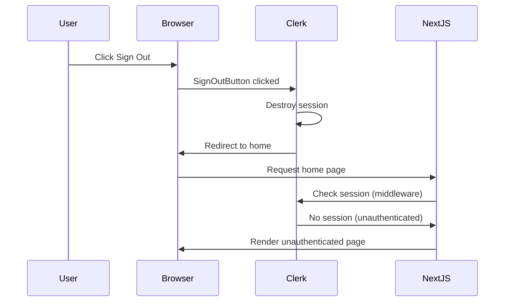

# Authentication Guide

## Overview

This guide explains how authentication and authorization work in Socially using Clerk.

## Authentication Provider

**Service:** Clerk (@clerk/nextjs 6.9.6)

**Purpose:** Handles all authentication operations:
- User registration (sign up)
- User login (sign in)
- User logout (sign out)
- Session management
- Password recovery (handled by Clerk)

**Documentation:** https://clerk.com/docs

## Clerk Integration

### ClerkProvider

**Location:** `src/app/layout.tsx`

The entire application is wrapped in ClerkProvider:

```typescript
import { ClerkProvider } from "@clerk/nextjs";

export default function RootLayout({ children }) {
  return (
    <ClerkProvider>
      {/* Application content */}
    </ClerkProvider>
  );
}
```

**Purpose:** Provides authentication context to all child components.

### Clerk Middleware

**Location:** `src/middleware.ts`

All routes are protected by Clerk middleware:

```typescript
import { clerkMiddleware } from "@clerk/nextjs/server";

export default clerkMiddleware();

export const config = {
  matcher: [
    "/((?!_next|[^?]*\\.(?:html?|css|js(?!on)|jpe?g|webp|png|gif|svg|ttf|woff2?|ico|csv|docx?|xlsx?|zip|webmanifest)).*)",
    "/(api|trpc)(.*)",
  ],
};
```

**Purpose:**
- Validates user session on every request
- Protects API routes
- Skips static files and Next.js internals

## Authentication Flow

### Sign Up Flow



### Sign In Flow



### Sign Out Flow



## User Sync Process

### syncUser Function

**Location:** `src/actions/user.action.ts`

**Purpose:** Sync Clerk user to local database.

**Called From:** `src/components/Navbar.tsx` on every page load when user is authenticated.

**Logic:**

```typescript
export async function syncUser() {
  try {
    // 1. Get Clerk user ID and user data
    const { userId } = await auth();
    const user = await currentUser();

    if (!userId || !user) return;

    // 2. Check if user exists in database
    const existingUser = await prisma.user.findUnique({
      where: { clerkId: userId },
    });

    // 3. If exists, return existing user
    if (existingUser) return existingUser;

    // 4. If not exists, create new user
    const dbUser = await prisma.user.create({
      data: {
        clerkId: userId,
        name: `${user.firstName || ""} ${user.lastName || ""}`,
        username: user.username ?? user.emailAddresses[0].emailAddress.split("@")[0],
        email: user.emailAddresses[0].emailAddress,
        image: user.imageUrl,
      },
    });

    return dbUser;
  } catch (error) {
    console.log("Error in syncUser", error);
  }
}
```

**Fields Synced:**
- `clerkId` - Clerk user ID (for authentication mapping)
- `name` - First and last name from Clerk
- `username` - Username from Clerk, or email prefix if not set
- `email` - Primary email from Clerk
- `image` - Profile image URL from Clerk

**Why Sync User?**
- Clerk handles authentication, but application needs local user data
- Local database stores posts, comments, likes, follows
- Clerk ID maps local user to Clerk session

## Authentication in Components

### Clerk UI Components

The application uses Clerk's pre-built UI components:

#### SignInButton

**Purpose:** Display sign in button.

**Usage:**
```typescript
import { SignInButton } from "@clerk/nextjs";

<SignInButton mode="modal">
  <Button>Sign In</Button>
</SignInButton>
```

**Mode:** "modal" (opens in modal dialog)

#### SignUpButton

**Purpose:** Display sign up button.

**Usage:**
```typescript
import { SignUpButton } from "@clerk/nextjs";

<SignUpButton mode="modal">
  <Button>Sign Up</Button>
</SignUpButton>
```

#### SignOutButton

**Purpose:** Display sign out button.

**Usage:**
```typescript
import { SignOutButton } from "@clerk/nextjs";

<SignOutButton>
  <Button>Sign Out</Button>
</SignOutButton>
```

#### UserButton

**Purpose:** Display user menu with account options.

**Usage:**
```typescript
import { UserButton } from "@clerk/nextjs";

<UserButton />
```

**Features:**
- User avatar
- Account management
- Sign out option

### Checking Authentication Status

#### In Server Components

```typescript
import { currentUser } from "@clerk/nextjs/server";

const user = await currentUser();

if (user) {
  // User is authenticated
  console.log(user.id, user.email);
} else {
  // User is not authenticated
}
```

#### In Client Components

```typescript
import { useUser } from "@clerk/nextjs";

const { user, isSignedIn } = useUser();

if (isSignedIn) {
  // User is authenticated
  console.log(user.id);
}
```

#### In Server Actions

```typescript
import { auth } from "@clerk/nextjs/server";

const { userId } = await auth();

if (!userId) {
  // User is not authenticated
  return;
}
```

## Getting Database User ID

### getDbUserId Function

**Location:** `src/actions/user.action.ts`

**Purpose:** Get local database user ID from Clerk session.

**Used By:** All Server Actions requiring authentication.

**Logic:**

```typescript
export async function getDbUserId() {
  // 1. Get Clerk user ID
  const { userId: clerkId } = await auth();
  if (!clerkId) return null;

  // 2. Fetch user from database by clerkId
  const user = await getUserByClerkId(clerkId);

  if (!user) throw new Error("User not found");

  // 3. Return database user ID
  return user.id;
}
```

**Usage Example:**
```typescript
import { getDbUserId } from "@/actions/user.action";

export async function createPost(content: string) {
  const userId = await getDbUserId();
  if (!userId) return; // User not authenticated

  // Create post with userId
}
```

## Authorization

### What is Authorization?

Authorization determines what an authenticated user is allowed to do.

### Post Deletion Authorization

**Location:** `src/actions/post.action.ts`

**Logic:**
```typescript
export async function deletePost(postId: string) {
  const userId = await getDbUserId();

  // Fetch post to check authorship
  const post = await prisma.post.findUnique({
    where: { id: postId },
    select: { authorId: true },
  });

  if (!post) throw new Error("Post not found");

  // Check if current user is the author
  if (post.authorId !== userId) {
    throw new Error("Unauthorized - no delete permission");
  }

  // Delete post
  await prisma.post.delete({ where: { id: postId } });
}
```

**Rule:** Only the post author can delete their own posts.

### Profile Editing Authorization

**Location:** `src/app/profile/[username]/ProfilePageClient.tsx`

**Logic:**
```typescript
const isOwnProfile =
  currentUser?.username === user.username ||
  currentUser?.emailAddresses[0].emailAddress.split("@")[0] === user.username;
```

**Rule:** Only the profile owner can edit their own profile.

### File Upload Authorization

**Location:** `src/app/api/uploadthing/core.ts`

**Logic:**
```typescript
.middleware(async () => {
  const { userId } = await auth();
  if (!userId) throw new Error("Unauthorized");
  return { userId };
})
```

**Rule:** Only authenticated users can upload files.

## Clerk Configuration

### Environment Variables

Required Clerk environment variables:

- `NEXT_PUBLIC_CLERK_PUBLISHABLE_KEY` - Public key for client-side
- `CLERK_SECRET_KEY` - Secret key for server-side

**How to Obtain:**
1. Create account at https://clerk.com
2. Create a new application
3. Get keys from Clerk dashboard

### Clerk Dashboard Configuration

**Settings to Configure:**

1. **Sign Up Methods:**
   - Email/password
   - Social providers (Google, GitHub, etc.)
   - Phone number (optional)

2. **Email Verification:**
   - Require email verification (recommended)
   - Email template customization

3. **Session Settings:**
   - Session duration
   - Remember me options

4. **User Attributes:**
   - First name
   - Last name
   - Username
   - Profile image

**Note:** The application syncs first name, last name, username, and profile image from Clerk.

## Session Management

### How Sessions Work

1. User signs in via Clerk
2. Clerk creates session and sets HTTP-only cookie
3. Cookie contains session token
4. Middleware validates cookie on each request
5. Clerk provides user information based on session

### Session Persistence

- Sessions persist via HTTP-only cookies
- Cookies are secure and cannot be accessed via JavaScript
- Clerk handles session refresh automatically
- Sessions expire according to Clerk settings

### Logout Behavior

When user logs out:
1. Clerk destroys session
2. Session cookie is cleared
3. User is redirected to home page
4. Application renders unauthenticated state

## Known Limitations

### Not Implemented

- **Two-Factor Authentication (2FA):** Can be enabled in Clerk dashboard but not configured
- **Email Verification:** Can be enabled in Clerk dashboard but not verified
- **Password Reset:** Handled by Clerk but not customized
- **Account Deletion:** Not implemented (must be done via Clerk dashboard)
- **Role-Based Access Control:** No admin roles or permissions
- **Social Sign-In:** Can be configured in Clerk but not set up

### Authorization Gaps

- No rate limiting on authentication attempts
- No account lockout after failed attempts
- No IP-based restrictions
- No device management

## Security Best Practices

### Do

- Use Clerk middleware to protect all routes
- Always check authentication in Server Actions
- Implement authorization checks for sensitive operations
- Use HTTPS in production
- Keep Clerk secret key secure (never commit to Git)

### Don't

- Don't store passwords in your database (Clerk handles this)
- Don't implement custom authentication logic
- Don't expose Clerk secret key to client
- Don't bypass Clerk middleware
- Don't store session tokens in local storage

## Troubleshooting

### Common Issues

**Issue:** "User not found" error
**Solution:** Ensure syncUser is called after Clerk authentication

**Issue:** Middleware not protecting routes
**Solution:** Check middleware.ts configuration and matcher

**Issue:** Clerk components not rendering
**Solution:** Ensure ClerkProvider wraps the application

**Issue:** Session not persisting
**Solution:** Check cookie settings and Clerk configuration

### Debugging

**Check Clerk Session:**
```typescript
import { auth } from "@clerk/nextjs/server";

const { userId } = await auth();
console.log("User ID:", userId);
```

**Check Database User:**
```typescript
import { getUserByClerkId } from "@/actions/user.action";

const user = await getUserByClerkId(clerkId);
console.log("Database user:", user);
```

## Clerk Dashboard

**URL:** https://dashboard.clerk.com

**Features:**
- View all users
- Manage user sessions
- Configure authentication settings
- Monitor authentication events
- Configure social providers
- Customize email templates

## Next Steps

For more information on:
- Frontend architecture: See [FRONTEND_GUIDE.md](./FRONTEND_GUIDE.md)
- Backend architecture: See [BACKEND_GUIDE.md](./BACKEND_GUIDE.md)
- Database structure: See [DATABASE_GUIDE.md](./DATABASE_GUIDE.md)
- Environment setup: See [ENVIRONMENT_SETUP.md](./ENVIRONMENT_SETUP.md)
