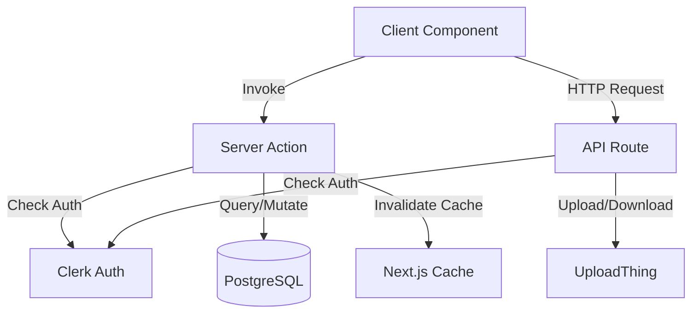
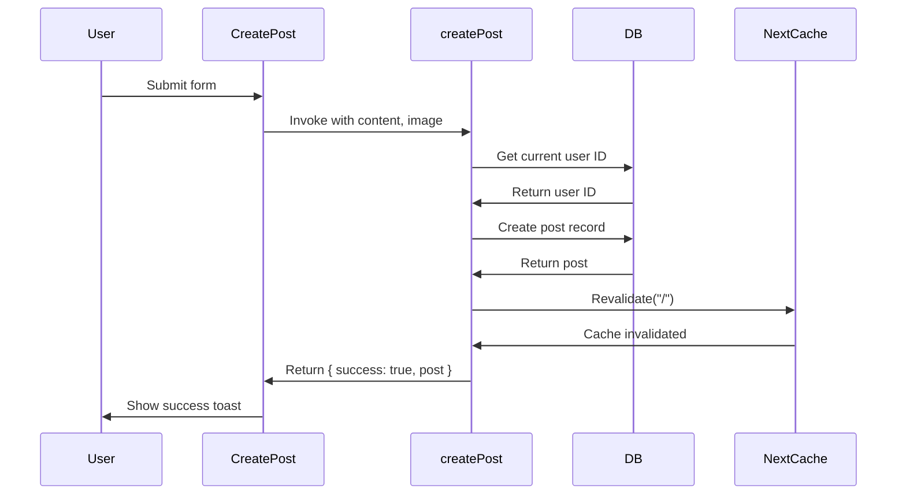
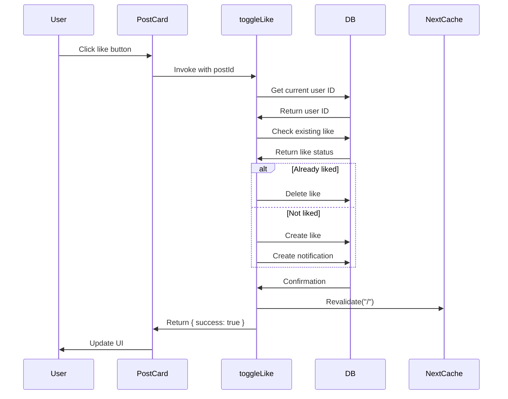

# Backend Guide

## Overview

This guide explains the backend architecture of Socially, including Server Actions, API routes, business logic, and request flow.

## Technology Stack

- **Framework:** Next.js 14.2.15 (App Router)
- **Runtime:** Node.js
- **Database ORM:** Prisma 6.1.0
- **Database:** PostgreSQL
- **Authentication:** Clerk (@clerk/nextjs 6.9.6)
- **File Storage:** UploadThing (uploadthing 7.4.2)

## Backend Architecture

Socially uses Next.js with two backend patterns:

1. **Server Actions** - Primary business logic for database operations
2. **API Routes** - External service integrations and demo endpoints



## Server Actions

Server Actions are the primary backend logic for the application. They run on the server and can be called directly from client components.

### Location

All Server Actions are in the `src/actions/` directory:

- `src/actions/post.action.ts` - Post-related operations
- `src/actions/user.action.ts` - User-related operations
- `src/actions/profile.action.ts` - Profile-related operations
- `src/actions/notification.action.ts` - Notification operations

### Server Action Pattern

All Server Actions follow this pattern:

```typescript
"use server";

import prisma from "@/lib/prisma";
import { revalidatePath } from "next/cache";

export async function actionName(params: ParamType) {
  try {
    // 1. Authenticate user
    const userId = await getDbUserId();
    if (!userId) return;

    // 2. Perform database operation
    const result = await prisma.model.create({ data: params });

    // 3. Invalidate cache
    revalidatePath("/");

    // 4. Return success
    return { success: true, result };
  } catch (error) {
    console.error("Error message", error);
    return { success: false, error: "Error message" };
  }
}
```

### Key Principles

1. **"use server" directive** - Marks function as Server Action
2. **Authentication check** - Verify user is logged in
3. **Database operations** - Use Prisma ORM
4. **Cache invalidation** - Use `revalidatePath` after mutations
5. **Error handling** - Try-catch with user-friendly error messages
6. **Return object** - Always return `{ success: boolean, data?: any, error?: string }`

## Post Actions

**File:** `src/actions/post.action.ts`

### createPost

**Purpose:** Create a new post with optional image.

**Parameters:**
- `content` (string) - Post text content
- `image` (string) - UploadThing image URL

**Returns:**
- `{ success: true, post }` on success
- `{ success: false, error }` on failure

**Logic:**
1. Get current user ID from Clerk
2. Create post record in database
3. Invalidate home page cache
4. Return success with post data

**Example:**
```typescript
const result = await createPost("Hello world", "https://uploadthing.com/image.jpg");
```

### getPosts

**Purpose:** Fetch all posts with author, comments, and likes.

**Parameters:** None

**Returns:** Array of post objects with nested data

**Data Included:**
- Post author (id, name, image, username)
- Comments with author info
- Likes (user IDs only)
- Counts (likes, comments)

**Ordering:** Chronological (newest first)

**Example:**
```typescript
const posts = await getPosts();
// posts[0].author.name
// posts[0].comments[0].author.username
// posts[0]._count.likes
```

### toggleLike

**Purpose:** Like or unlike a post.

**Parameters:**
- `postId` (string) - Post ID to like/unlike

**Returns:**
- `{ success: true }` on success
- `{ success: false, error }` on failure

**Logic:**
1. Get current user ID
2. Check if user already liked the post
3. If liked: Delete like record
4. If not liked: Create like record AND create notification (if not own post)
5. Invalidate home page cache
6. Return success

**Notification:** Creates LIKE notification if liking someone else's post

**Example:**
```typescript
await toggleLike("post_123");
```

### createComment

**Purpose:** Add a comment to a post.

**Parameters:**
- `postId` (string) - Post ID
- `content` (string) - Comment text

**Returns:**
- `{ success: true, comment }` on success
- `{ success: false, error }` on failure

**Logic:**
1. Get current user ID
2. Validate content is not empty
3. Create comment record
4. Create notification (if commenting on someone else's post)
5. Use transaction for atomicity
6. Invalidate home page cache
7. Return success with comment data

**Notification:** Creates COMMENT notification if commenting on someone else's post

**Example:**
```typescript
await createComment("post_123", "Great post!");
```

### deletePost

**Purpose:** Delete a post (only by author).

**Parameters:**
- `postId` (string) - Post ID to delete

**Returns:**
- `{ success: true }` on success
- `{ success: false, error }` on failure

**Logic:**
1. Get current user ID
2. Fetch post to check authorship
3. Verify current user is the author
4. Delete post record (cascade deletes comments, likes, notifications)
5. Invalidate home page cache
6. Return success

**Authorization:** Only post author can delete

**Example:**
```typescript
await deletePost("post_123");
```

## User Actions

**File:** `src/actions/user.action.ts`

### syncUser

**Purpose:** Sync Clerk user to local database.

**Parameters:** None (uses current Clerk session)

**Returns:** User object from database

**Logic:**
1. Get current Clerk user ID and user data
2. Check if user exists in database by clerkId
3. If exists: Return existing user
4. If not exists: Create new user record with Clerk data
5. Return user object

**Called From:** Navbar component on every page load

**Fields Synced:**
- `clerkId` - Clerk user ID
- `name` - First and last name
- `username` - Username or email prefix
- `email` - Primary email
- `image` - Profile image URL

**Example:**
```typescript
const user = await syncUser();
```

### getUserByClerkId

**Purpose:** Fetch user from database by Clerk ID.

**Parameters:**
- `clerkId` (string) - Clerk user ID

**Returns:** User object with counts

**Data Included:**
- User fields
- Counts (followers, following, posts)

**Example:**
```typescript
const user = await getUserByClerkId("clerk_123");
// user._count.followers
```

### getDbUserId

**Purpose:** Get database user ID from Clerk session.

**Parameters:** None

**Returns:** Database user ID (string) or null

**Logic:**
1. Get Clerk user ID from session
2. Fetch user from database by clerkId
3. Return database user ID

**Used By:** All Server Actions requiring authentication

**Example:**
```typescript
const userId = await getDbUserId();
```

### getRandomUsers

**Purpose:** Get 3 random users to suggest for following.

**Parameters:** None

**Returns:** Array of user objects

**Filters:**
- Excludes current user
- Excludes users already followed by current user

**Data Included:**
- User id, name, username, image
- Follower count

**Example:**
```typescript
const users = await getRandomUsers();
// users[0].name
// users[0]._count.followers
```

### toggleFollow

**Purpose:** Follow or unfollow a user.

**Parameters:**
- `targetUserId` (string) - User ID to follow/unfollow

**Returns:**
- `{ success: true }` on success
- `{ success: false, error }` on failure

**Logic:**
1. Get current user ID
2. Prevent self-follow
3. Check if already following
4. If following: Delete follow record
5. If not following: Create follow record AND create notification
6. Invalidate home page cache
7. Return success

**Notification:** Creates FOLLOW notification

**Example:**
```typescript
await toggleFollow("user_456");
```

## Profile Actions

**File:** `src/actions/profile.action.ts`

### getProfileByUsername

**Purpose:** Fetch user profile by username.

**Parameters:**
- `username` (string) - Username

**Returns:** User profile object with counts

**Data Included:**
- User fields (id, name, username, bio, image, location, website, createdAt)
- Counts (followers, following, posts)

**Example:**
```typescript
const profile = await getProfileByUsername("johndoe");
// profile.bio
// profile._count.followers
```

### getUserPosts

**Purpose:** Fetch all posts by a specific user.

**Parameters:**
- `userId` (string) - User ID

**Returns:** Array of post objects with nested data

**Data Included:**
- Post with author, comments, likes
- Counts (likes, comments)

**Ordering:** Chronological (newest first)

**Example:**
```typescript
const posts = await getUserPosts("user_123");
```

### getUserLikedPosts

**Purpose:** Fetch all posts liked by a specific user.

**Parameters:**
- `userId` (string) - User ID

**Returns:** Array of post objects with nested data

**Data Included:**
- Post with author, comments, likes
- Counts (likes, comments)

**Ordering:** Chronological (newest first)

**Example:**
```typescript
const likedPosts = await getUserLikedPosts("user_123");
```

### updateProfile

**Purpose:** Update user profile information.

**Parameters:**
- `formData` (FormData) - Form data with profile fields

**Fields:**
- `name` - Display name
- `bio` - Biography
- `location` - Location
- `website` - Website URL

**Returns:**
- `{ success: true, user }` on success
- `{ success: false, error }` on failure

**Logic:**
1. Get Clerk user ID
2. Update user record in database
3. Invalidate profile page cache
4. Return success with updated user

**Example:**
```typescript
const formData = new FormData();
formData.append("name", "John Doe");
formData.append("bio", "Developer");
const result = await updateProfile(formData);
```

### isFollowing

**Purpose:** Check if current user follows a specific user.

**Parameters:**
- `userId` (string) - User ID to check

**Returns:** Boolean (true if following, false if not)

**Logic:**
1. Get current user ID
2. Check for follow relationship in database
3. Return boolean

**Example:**
```typescript
const following = await isFollowing("user_456");
```

## Notification Actions

**File:** `src/actions/notification.action.ts`

### getNotifications

**Purpose:** Fetch all notifications for current user.

**Parameters:** None

**Returns:** Array of notification objects

**Data Included:**
- Notification fields
- Creator info (id, name, username, image)
- Post info (id, content, image) - if applicable
- Comment info (id, content, createdAt) - if applicable

**Ordering:** Chronological (newest first)

**Example:**
```typescript
const notifications = await getNotifications();
// notifications[0].type
// notifications[0].creator.name
```

### markNotificationsAsRead

**Purpose:** Mark notifications as read.

**Parameters:**
- `notificationIds` (string[]) - Array of notification IDs

**Returns:**
- `{ success: true }` on success
- `{ success: false }` on failure

**Logic:**
1. Update notification records
2. Set `read` field to true
3. Return success

**Example:**
```typescript
await markNotificationsAsRead(["notif_1", "notif_2"]);
```

## API Routes

API Routes handle external service integrations and demo endpoints.

### UploadThing Route

**File:** `src/app/api/uploadthing/route.ts`

**Route:** `/api/uploadthing`

**Purpose:** UploadThing file upload handler.

**Methods:** GET, POST

**Configuration File:** `src/app/api/uploadthing/core.ts`

**Endpoint:** `postImage`

**Middleware:**
- Validates Clerk authentication
- Returns user ID as metadata

**Configuration:**
- Max file size: 4MB
- Max file count: 1
- File types: Images only

**Upload Flow:**
1. Client uploads file to UploadThing
2. UploadThing calls middleware for authorization
3. Middleware validates Clerk session
4. File stored on UploadThing servers
5. UploadThing returns file URL
6. URL stored in Post.image field

**Example Usage:**
```typescript
// In ImageUpload component
<UploadDropzone
  endpoint="postImage"
  onClientUploadComplete={(res) => {
    onChange(res?.[0].url);
  }}
/>
```

### Tasks Route (Demo)

**File:** `src/app/api/tasks/route.ts`

**Route:** `/api/tasks`

**Purpose:** Demo API route with in-memory storage.

**Status:** Not part of core features. Can be removed in production.

**Methods:**
- GET - Fetch all tasks
- POST - Create new task
- DELETE - Delete task by ID

**Storage:** In-memory array (not persistent)

**Example:**
```typescript
// GET
const response = await fetch("/api/tasks");
const tasks = await response.json();

// POST
await fetch("/api/tasks", {
  method: "POST",
  body: JSON.stringify({ title: "New task" }),
});

// DELETE
await fetch("/api/tasks?id=1", { method: "DELETE" });
```

## Database Access

### Prisma Client

**File:** `src/lib/prisma.ts`

**Purpose:** Singleton Prisma client instance.

**Pattern:**
```typescript
import { PrismaClient } from "@prisma/client";

const prisma = globalThis.prismaGlobal ?? new PrismaClient();

export default prisma;

if (process.env.NODE_ENV !== "production") {
  globalThis.prismaGlobal = prisma;
}
```

**Usage:**
```typescript
import prisma from "@/lib/prisma";

const users = await prisma.user.findMany();
```

### Common Prisma Operations

#### Create
```typescript
const post = await prisma.post.create({
  data: {
    content: "Hello",
    authorId: userId,
  },
});
```

#### Read
```typescript
const post = await prisma.post.findUnique({
  where: { id: postId },
  include: { author: true },
});
```

#### Update
```typescript
const user = await prisma.user.update({
  where: { id: userId },
  data: { bio: "New bio" },
});
```

#### Delete
```typescript
await prisma.post.delete({
  where: { id: postId },
});
```

#### Transaction
```typescript
await prisma.$transaction([
  prisma.like.create({ data: { userId, postId } }),
  prisma.notification.create({ data: { type: "LIKE", userId, creatorId } }),
]);
```

## Authentication in Server Actions

### Getting Current User

All Server Actions use `getDbUserId()` to get the current user:

```typescript
import { getDbUserId } from "./user.action";

const userId = await getDbUserId();
if (!userId) return; // User not authenticated
```

### Clerk Auth

```typescript
import { auth } from "@clerk/nextjs/server";

const { userId } = await auth();
```

### Authorization Checks

Example: Post deletion authorization

```typescript
const post = await prisma.post.findUnique({
  where: { id: postId },
  select: { authorId: true },
});

if (post.authorId !== userId) {
  throw new Error("Unauthorized - no delete permission");
}
```

## Cache Invalidation

### revalidatePath

Server Actions use `revalidatePath` to invalidate Next.js cache:

```typescript
import { revalidatePath } from "next/cache";

revalidatePath("/"); // Invalidate home page
revalidatePath("/profile"); // Invalidate profile pages
```

### When to Invalidate

- After creating a post
- After liking/unliking
- After commenting
- After deleting a post
- After following/unfollowing
- After updating profile

## Error Handling

### Server Action Error Pattern

```typescript
try {
  // Operation
  return { success: true, data };
} catch (error) {
  console.error("Error message", error);
  return { success: false, error: "User-friendly error message" };
}
```

### Client-Side Error Handling

```typescript
const result = await serverAction();
if (result?.success) {
  toast.success("Success");
} else {
  toast.error(result.error || "Failed");
}
```

## Request Flow Examples

### Creating a Post



### Liking a Post



## Security Considerations

### Authentication

- All Server Actions check for authenticated user
- Clerk middleware protects all routes
- Server Actions return early if user not authenticated

### Authorization

- Post deletion requires authorship check
- Profile editing requires ownership check
- File uploads require authenticated user

### SQL Injection Prevention

- Prisma ORM prevents SQL injection
- Never use raw SQL queries
- Always use Prisma's query builder

### Input Validation

- Content validation in createComment
- Prevent self-follow
- Validate post existence before operations

### Known Security Gaps

- No rate limiting on Server Actions
- No input sanitization beyond ORM
- No request size limits
- No brute-force protection

See [SECURITY.md](./SECURITY.md) for detailed security information.

## Performance Considerations

### Database Indexes

The following indexes improve query performance:

- Comment: (authorId, postId)
- Like: (userId, postId)
- Follows: (followerId, followingId)
- Notification: (userId, createdAt)

### Query Optimization

- Use `select` to fetch only needed fields
- Use `include` for relationships
- Use `take` and `skip` for pagination (not currently implemented)
- Use indexes where defined

### Transactions

Use transactions for atomic operations:

```typescript
await prisma.$transaction([
  prisma.like.create({ data }),
  prisma.notification.create({ data }),
]);
```

## Testing Server Actions

**NOT IMPLEMENTED:** No automated tests exist for Server Actions.

**Manual Testing:**
1. Start development server
2. Navigate to application
3. Perform actions (create post, like, comment)
4. Verify database state
5. Check browser console for errors

## Debugging

### Console Logging

Server Actions use console.error for error logging:

```typescript
console.error("Failed to create post:", error);
```

### Prisma Logging

Enable Prisma logging in development:

```typescript
// In prisma.ts
const prisma = new PrismaClient({
  log: ["query", "error", "warn"],
});
```

### Next.js Logging

Next.js provides server logs in the terminal.

## Best Practices

### Do

- Always check authentication in Server Actions
- Use try-catch for error handling
- Invalidate cache after mutations
- Return consistent response objects
- Use transactions for multi-step operations
- Select only needed fields from database

### Don't

- Don't expose sensitive data in responses
- Don't use raw SQL queries
- Don't forget to invalidate cache
- Don't return database errors directly to client
- Don't perform expensive operations in Server Actions

## Next Steps

For more information on:
- Frontend architecture: See [FRONTEND_GUIDE.md](./FRONTEND_GUIDE.md)
- Database structure: See [DATABASE_GUIDE.md](./DATABASE_GUIDE.md)
- Authentication: See [AUTHENTICATION_GUIDE.md](./AUTHENTICATION_GUIDE.md)
- File uploads: See [MEDIA_STORAGE_GUIDE.md](./MEDIA_STORAGE_GUIDE.md)
