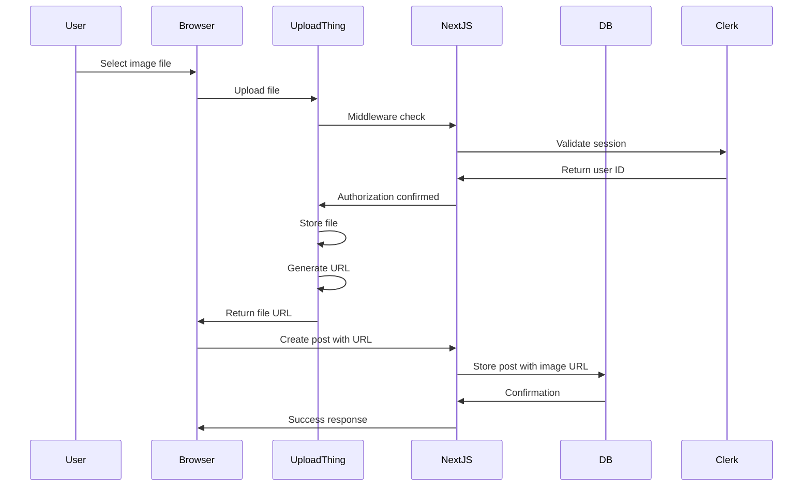

# Media Storage Guide

## Overview

This guide explains how image uploads and storage work in Socially using UploadThing.

## Storage Provider

**Service:** UploadThing (@uploadthing/react 7.1.4, uploadthing 7.4.2)

**Purpose:** Handle file uploads, storage, and delivery.

**Documentation:** https://uploadthing.com/docs

**Current Support:** Images only (no video uploads)

## UploadThing Configuration

### Configuration File

**Location:** `src/app/api/uploadthing/core.ts`

### File Router Definition

```typescript
import { createUploadthing, type FileRouter } from "uploadthing/next";
import { auth } from "@clerk/nextjs/server";

const f = createUploadthing();

export const ourFileRouter = {
  postImage: f({
    image: {
      maxFileSize: "4MB",
      maxFileCount: 1,
    },
  })
    .middleware(async () => {
      const { userId } = await auth();
      if (!userId) throw new Error("Unauthorized");
      return { userId };
    })
    .onUploadComplete(async ({ metadata, file }) => {
      try {
        return { fileUrl: file.url };
      } catch (error) {
        console.error("Error in onUploadComplete:", error);
        throw error;
      },
    }),
} satisfies FileRouter;

export type OurFileRouter = typeof ourFileRouter;
```

### Configuration Details

**Endpoint Name:** `postImage`

**File Type:** Images only

**Constraints:**
- **Max File Size:** 4MB
- **Max File Count:** 1 per post
- **File Types:** Images (JPEG, PNG, GIF, WebP, etc.)

**Middleware:**
- Validates Clerk authentication
- Returns user ID as metadata
- Rejects uploads from unauthenticated users

**onUploadComplete:**
- Called after successful upload
- Returns file URL
- Stores URL in database

### API Route

**Location:** `src/app/api/uploadthing/route.ts`

```typescript
import { createRouteHandler } from "uploadthing/next";
import { ourFileRouter } from "./core";

export const { GET, POST } = createRouteHandler({
  router: ourFileRouter,
});
```

**Route:** `/api/uploadthing`

**Methods:** GET, POST

**Purpose:** UploadThing file upload handler.

## Upload Workflow

### Complete Upload Flow



### Step-by-Step Process

1. **User Selects File**
   - User clicks "Photo" button in CreatePost component
   - File selection dialog opens
   - User selects image file

2. **File Upload**
   - UploadThing dropzone uploads file to UploadThing servers
   - UploadThing middleware validates authentication
   - File is stored on UploadThing's cloud storage

3. **URL Generation**
   - UploadThing generates file URL
   - URL is returned to client
   - URL is stored in component state

4. **Post Creation**
   - User submits post form
   - Server Action receives image URL
   - URL is stored in Post.image field in database

5. **File Delivery**
   - Post is displayed with image
   - Image URL is used in `` tag
   - UploadThing CDN delivers image

## Client-Side Components

### ImageUpload Component

**Location:** `src/components/ImageUpload.tsx`

**Purpose:** UploadThing dropzone wrapper for image uploads.

**Props:**
- `endpoint` - UploadThing endpoint name ("postImage")
- `onChange` - Callback when URL changes
- `value` - Current image URL

**Logic:**

```typescript
function ImageUpload({ endpoint, onChange, value }: ImageUploadProps) {
  if (value) {
    // Display image preview with delete button
    return (
      <div className="relative size-40">
        
        <button onClick={() => onChange("")}>
          <XIcon />
        </button>
      </div>
    );
  }

  // Display upload dropzone
  return (
    <UploadDropzone
      endpoint={endpoint}
      onClientUploadComplete={(res) => {
        onChange(res?.[0].url);
      }}
      onUploadError={(error: Error) => {
        console.log(error);
      }}
    />
  );
}
```

**Features:**
- Image preview when URL exists
- Delete button to remove image
- UploadThing dropzone for new uploads
- Error handling

### CreatePost Component

**Location:** `src/components/CreatePost.tsx`

**Purpose:** Post creation form with image upload.

**Image Upload Logic:**

```typescript
const [imageUrl, setImageUrl] = useState("");
const [showImageUpload, setShowImageUpload] = useState(false);

// In JSX
{(showImageUpload || imageUrl) && (
  <div className="border rounded-lg p-4">
    <ImageUpload
      endpoint="postImage"
      value={imageUrl}
      onChange={(url) => {
        setImageUrl(url);
        if (!url) setShowImageUpload(false);
      }}
    />
  </div>
)}
```

**State:**
- `imageUrl` - Stores uploaded image URL
- `showImageUpload` - Controls upload UI visibility

### UploadThing Components

**Location:** `src/lib/uploadthing.ts`

```typescript
import type { OurFileRouter } from "@/app/api/uploadthing/core";
import { generateUploadButton, generateUploadDropzone } from "@uploadthing/react";

export const UploadButton = generateUploadButton<OurFileRouter>();
export const UploadDropzone = generateUploadDropzone<OurFileRouter>();
```

**Purpose:** Generate typed UploadThing components.

## Server-Side Integration

### Creating Post with Image

**Location:** `src/actions/post.action.ts`

```typescript
export async function createPost(content: string, image: string) {
  try {
    const userId = await getDbUserId();
    if (!userId) return;

    const post = await prisma.post.create({
      data: {
        content,
        image, // UploadThing URL
        authorId: userId,
      },
    });

    revalidatePath("/");
    return { success: true, post };
  } catch (error) {
    console.error("Failed to create post:", error);
    return { success: false, error: "Failed to create post" };
  }
}
```

**Database Storage:**
- Only the URL string is stored in the database
- The actual file is stored on UploadThing servers
- URL format: `https://utfs.io/f/...`

### Displaying Images

**Location:** `src/components/PostCard.tsx`

```typescript
{post.image && (
  <div className="rounded-lg overflow-hidden">
    
  </div>
)}
```

**Display Logic:**
- Check if post.image exists
- Render `` tag with URL
- Use responsive sizing classes

## UploadThing Account Setup

### Required Environment Variable

- `UPLOADTHING_TOKEN` - UploadThing API token

### How to Obtain UploadThing Token

1. Create account at https://uploadthing.com
2. Create a new app
3. Get API token from dashboard
4. Add to `.env` file:
   ```
   UPLOADTHING_TOKEN=your_token_here
   ```

### UploadThing Dashboard

**URL:** https://uploadthing.com/dashboard

**Features:**
- View all uploaded files
- Manage file storage
- Monitor upload statistics
- Configure file type limits
- Configure file size limits
- View API usage

## File Storage Details

### Where Files Are Stored

- **Storage Location:** UploadThing cloud storage (managed service)
- **Delivery:** UploadThing CDN
- **Backup:** UploadThing handles backups
- **Access Control:** Public URLs (anyone with URL can access)

### File URL Format

UploadThing URLs typically look like:
```
https://utfs.io/f/unique-file-id
```

### File Lifecycle

1. **Upload:** User uploads file via UploadThing
2. **Storage:** File stored on UploadThing servers
3. **URL Generation:** UploadThing generates public URL
4. **Database Storage:** URL stored in Post.image field
5. **Display:** Image displayed using URL
6. **Post Deletion:** Database record deleted, but file remains on UploadThing

### File Deletion

**CURRENT BEHAVIOR:**
- When a post is deleted, only the database record is removed
- The file remains on UploadThing servers
- This may result in orphaned files and storage costs

**Example from deletePost:**
```typescript
export async function deletePost(postId: string) {
  // ... authorization check ...

  await prisma.post.delete({
    where: { id: postId },
  });

  // NOTE: File is NOT deleted from UploadThing
  revalidatePath("/");
  return { success: true };
}
```

**RECOMMENDED IMPROVEMENT:**
Implement file deletion in deletePost action using UploadThing's deletion API.

## File Validation

### UploadThing Validation

UploadThing enforces the following constraints:

- **File Type:** Only images allowed
- **File Size:** Maximum 4MB
- **File Count:** Maximum 1 per post

### Client-Side Validation

The ImageUpload component handles:
- File type validation (via UploadThing)
- File size validation (via UploadThing)
- Error display (via onUploadError)

### Server-Side Validation

The middleware ensures:
- User is authenticated before upload
- Invalid uploads are rejected

## Known Limitations

### Not Implemented

- **Video Uploads:** Only images are supported
- **File Deletion:** Deleting a post does not delete the file from UploadThing
- **File Editing:** No image editing or cropping
- **Thumbnail Generation:** No custom thumbnails (UploadThing may provide this)
- **File Compression:** No custom compression (UploadThing may provide this)
- **Multiple Files:** Only 1 file per post
- **Private Files:** All files are publicly accessible via URL
- **File Expiration:** No automatic file expiration

### Storage Considerations

- **Costs:** UploadThing has free tier limits, then charges based on storage
- **Orphaned Files:** Files may accumulate from deleted posts
- **No Cleanup:** No automatic cleanup of unused files

## Performance Considerations

### CDN Delivery

UploadThing provides CDN delivery for:
- Fast image loading
- Geographic distribution
- Automatic optimization

### Image Optimization

UploadThing may provide:
- Automatic format conversion (WebP, AVIF)
- Responsive image variants
- Lazy loading support

### Caching

Images can be cached by:
- Browser cache
- CDN cache
- Next.js image optimization (not currently used)

## Security Considerations

### File Type Validation

- UploadThing validates file types
- Only images are allowed
- Executable files are rejected

### File Size Limits

- Maximum 4MB per file
- Prevents oversized uploads
- Reduces storage costs

### Authentication

- Uploads require authenticated user
- Clerk middleware validates session
- Unauthenticated uploads are rejected

### URL Security

- File URLs are public
- Anyone with URL can access file
- No access control beyond authentication during upload

### Known Security Gaps

- No virus scanning of uploaded files
- No content moderation of images
- No rate limiting on uploads
- File URLs are predictable (may be guessable)

## Troubleshooting

### Common Issues

**Issue:** Upload fails with "Unauthorized" error
**Solution:** Ensure user is authenticated and Clerk session is valid

**Issue:** File too large error
**Solution:** Ensure file is under 4MB limit

**Issue:** Invalid file type error
**Solution:** Ensure file is an image (JPEG, PNG, GIF, WebP)

**Issue:** UploadThing token invalid
**Solution:** Verify UPLOADTHING_TOKEN is correct in .env

**Issue:** Image not displaying
**Solution:** Check if URL is valid and accessible

### Debugging

**Check UploadThing Dashboard:**
- View upload logs
- Check file storage
- Monitor API usage

**Console Logging:**
```typescript
onUploadError={(error: Error) => {
  console.log("Upload error:", error);
}}
```

## Best Practices

### Do

- Validate file uploads on both client and server
- Use appropriate file size limits
- Implement file deletion when deleting posts
- Monitor storage usage in UploadThing dashboard
- Use UploadThing's CDN for delivery

### Don't

- Don't upload files without authentication
- Don't store large files (keep under 4MB)
- Don't forget to delete files when deleting posts
- Don't expose UploadThing token in client code
- Don't upload executable files

## Future Improvements

### Recommended Enhancements

1. **File Deletion:** Implement file deletion when posts are deleted
2. **Video Support:** Add video upload endpoint
3. **Multiple Files:** Allow multiple images per post
4. **Image Editing:** Add cropping or editing tools
5. **File Expiration:** Implement automatic cleanup of old files
6. **Private Files:** Implement access control for sensitive files
7. **Compression:** Add custom compression logic
8. **Moderation:** Add content moderation for images

## UploadThing Resources

- **Documentation:** https://uploadthing.com/docs
- **Dashboard:** https://uploadthing.com/dashboard
- **API Reference:** https://uploadthing.com/docs/api
- **Examples:** https://uploadthing.com/examples

## Next Steps

For more information on:
- Frontend architecture: See [FRONTEND_GUIDE.md](./FRONTEND_GUIDE.md)
- Backend architecture: See [BACKEND_GUIDE.md](./BACKEND_GUIDE.md)
- Authentication: See [AUTHENTICATION_GUIDE.md](./AUTHENTICATION_GUIDE.md)
- Environment setup: See [ENVIRONMENT_SETUP.md](./ENVIRONMENT_SETUP.md)
